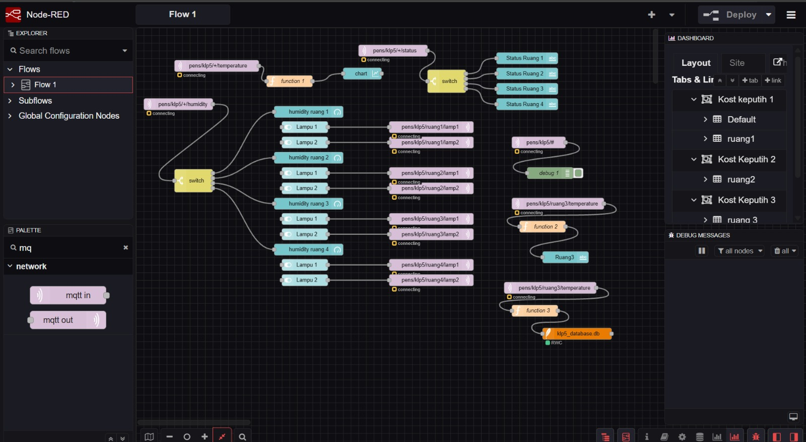
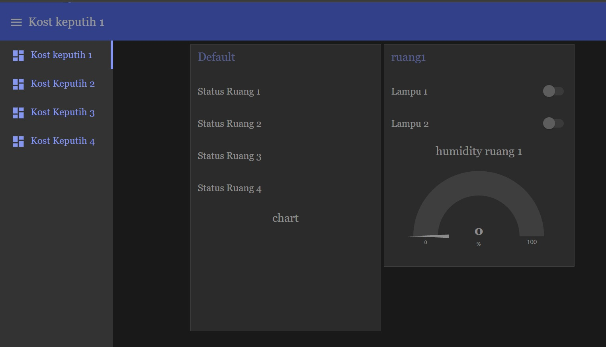

# Sistem Monitoring dan Kontrol Multi-Ruangan Berbasis ESP32, MQTT, dan Node-RED (Kelompok 05)

Sistem *Internet of Things* (IoT) untuk memantau suhu dan kelembapan secara *real-time*, serta mengendalikan aktuator (Lampu 1 dan Lampu 2) pada 4 ruangan yang berbeda. Sistem ini menggunakan mikrokontroler ESP32 dan ESP32-C3 yang mengirim serta menerima data menggunakan protokol MQTT melalui *broker* local (`Mosquitto`) yang dilengkapi dengan keamanan (*authentication*). Seluruh data sensor dan status perangkat divisualisasikan secara terpusat pada *dashboard* Node-RED, dilengkapi dengan fitur keandalan sistem seperti *Last Will and Testament* (LWT), *state feedback* aktuator, dan notifikasi peringatan suhu panas (*toast notification*).

## Anggota Kelompok

| Nama | NRP | Ruangan yang Dipegang |
|---|---|---|
| M. Nasirudin | 2124600062 | Ruang 4 |
| Helmi Zavelda P | 2124600064 | Ruang 2 |
| Efendi Choiri S | 2124600084 | Ruang 3 |
| Mochamad Nizar Abrar | 2124600075 |  |

## Link Video

* **Video Presentasi:** [Masukkan Link Video Presentasi di Sini](#)
* **Video Demo:** https://youtu.be/uO7uomSXTIM(#) atau buka file [`video.md`](video.md)

## Arsitektur Sistem

```text
[Node ESP32 + Sensor DHT22 + LED] 
        | (WiFi)
        v
[Broker MQTT Lokal (Mosquitto dengan Password)] 
        |
        v
[Node-RED (Server)] ---> [SQLite (Database Riwayat)]
        |
        v
[Node-RED Dashboard (Web UI)]
```
*(Atau ganti blok teks di atas dengan memanggil gambar arsitektur: ``)*

## Hardware
> 📌 **Catatan Khusus Hardware & Simulasi:**
> - **Ruang 3 (`esp3_pot`):** Menggunakan **2 Potensiometer** sebagai input analog untuk **menyimulasikan perubahan nilai suhu dan kelembaban** (pembacaan ADC dipetakan ke rentang 20.0 °C – 50.0 °C). Hal ini dilakukan sesuai dengan ketentuan variasi input sensor pada proyek evaluasi.
> - **Ruang 1, 2, dan 4:** Menggunakan sensor fisik riil, masing-masing **SHT40** (`ruang1`), **SHT30** (`ruang2`), dan **DHT22** (`ruang4`).

**Daftar Komponen:**
* Ruang 1
  *  ESP32 devkit v1
  *  SHT40
* Ruang 2
  *  ESP32 devkit v1
  *  SHT30
* Ruang 3
  *  ESP32 devkit v1
  *  Potensiometer 1(Simulasi Suhu)
  *  Potensiometer 2(Simulasi Kelembaban)
* Ruang 4
  *  Esp32 C3 Super Mini
  *  DHT22
* Komponen Pendukung
  * LED 1
  * LED 2
  * Resistor & Kabel Jumper
  * Breadboard

**Tabel Pin:**

| Ruangan / Node | Board | Sensor / Input | Lampu 1 | Lampu 2 |
| :--- | :--- | :--- | :--- | :--- |
| **Ruang 1** | SHT40 (SDA: GPIO21, SCL: GPIO22) | GPIO 14 | GPIO 27 |
| **Ruang 2** | SHT30 (SDA: GPIO21, SCL: GPIO22) | GPIO 14 | GPIO 27 |
| **Ruang 3** | Potensiometer 1 (ADC: GPIO34), Potensiometer (ADC: GPIO34) | GPIO 14 | GPIO 27 |
| **Ruang 4** | DHT22 (Data: GPIO 4) | GPIO 2 | GPIO 8 |

**Foto Rangkaian (Satu Ruangan):**

*(Catatan: Sesuaikan nama dan path gambar dengan yang ada di repository)*

## Tabel Topic Final dan Broker
> 📌 **Keterangan:** Huruf `N` pada `ruangN` mewakili nomor identitas ruangan (1, 2, 3, atau 4). 
> *Contoh penggunaannya: `pens/klp5/ruang1/temperature`, `pens/klp5/ruang4/lamp1`, dst.*

* **Broker yang dipakai:** Mosquitto Localhost

| Topic Full | Arah Data | Payload Format | QoS | Keterangan / Fungsi |
| :--- | :--- | :--- | :---: | :--- |
| `pens/klp5/ruangN/temperature` | ESP32 → Node-RED | String Float (°C) | 0 | Mengirim data suhu ruangan aktual |
| `pens/klp5/ruangN/humidity` | ESP32 → Node-RED | String Float (%) | 0 | Mengirim data kelembapan ruangan aktual |
| `pens/klp5/ruangN/lamp1` | Node-RED → ESP32 | `"1"` (ON) / `"0"` (OFF) | 1 | Menerima perintah kontrol Lampu 1 |
| `pens/klp5/ruangN/lamp2` | Node-RED → ESP32 | `"1"` (ON) / `"0"` (OFF) | 1 | Menerima perintah kontrol Lampu 2 |
| `pens/klp5/ruangN/status` | ESP32 / LWT → Node-RED | `"online"` / `"offline"` | 0 | Mengirim status koneksi perangkat (*Retained*) |
| `pens/klp5/ruangN/lamp1/state` | ESP32 → Node-RED | `"1"` (ON) / `"0"` (OFF) | 0 | *(Nilai Tambah)* Mengirim balik konfirmasi status fisik Lampu 1 (*Retained*) |
| `pens/klp5/ruangN/lamp2/state` | ESP32 → Node-RED | `"1"` (ON) / `"0"` (OFF) | 0 | *(Nilai Tambah)* Mengirim balik konfirmasi status fisik Lampu 2 (*Retained*) |

## Cara Menjalankan

**A. Sisi Firmware (VS Code & PlatformIO)**
1. **Buka Proyek:**
   - Buka VS Code, pilih menu **File** → **Open Folder...**, lalu buka folder proyek `firmware` (atau `node-redd`).

2. **Konfigurasi Kode (`src/*/main.cpp`):**
   - Buka file `main.cpp` pada folder node yang akan di-upload (misal `src/esp32c3/main.cpp` untuk Ruang 4).
   - Sesuaikan konstanta jaringan dan broker di bagian atas file:
     - `WIFI_SSID` dan `WIFI_PASS`
     - `BROKER_IP`
     - `MQTT_USER` dan `MQTT_PASS`

3. **Proses Build & Upload:**
     Buka Terminal (`Ctrl + ~`) dan jalankan perintah sesuai board target:
     - **Ruang 1 (SHT40):** `pio run -e esp1 -t upload`
     - **Ruang 2 (SHT30):** `pio run -e esp2 -t upload`
     - **Ruang 3 (Potensio):** `pio run -e esp3 -t upload`
     - **Ruang 4 (ESP32-C3):** `pio run -e esp32c3 -t upload`
   
**B. Sisi Node-RED & Database:**
1. Buka Node-RED, masuk ke *Manage Palette*, dan instal paket:
   * `node-red-dashboard`
   * `node-red-node-sqlite`
2. Lakukan *Import* file `flows.json` milik kelompok.
3. Sesuaikan *Username* dan *Password* pada node MQTT in/out sesuai keamanan broker Mosquitto. Klik **Deploy**.
4. **Alamat dashboard:** Buka browser dan akses `http://localhost:1880/ui`

## Screenshot Flow Node-RED dan Dashboard

**Flow Node-RED:**


**Dashboard UI:**


## Hasil Pengujian T1-T12

| Kode | Deskripsi Pengujian | Langkah / Cara Pengujian | Hasil (✓ / ×) | Keterangan Singkat |
|---|---|---|---|---|
| T1 | Koneksi | Buka Serial Monitor satu ESP32 | [✓] | Berhasil terhubung ke WiFi dan broker MQTT (muncul log "MQTT Connection established"). |
| T2 | Data 4 ruang | Nyalakan keempat ESP32 | [✓] | Keempat ESP32 berhasil mengirim data ke broker tanpa saling bertabrakan (Client ID unik). |
| T3 | Chart suhu | Buka http://localhost:1880/ui | [✓] | Grafik garis suhu dari keempat ruangan berhasil tampil dan update secara real-time. |
| T4 | Sensor berubah | Tiup / genggam sensor di ruang2 (atau putar potensio di ruang3) | [✓] | Nilai telemetri di dashboard UI langsung berubah naik/turun merespons input fisik hardware. |
| T5 | Lampu tepat sasaran | Nyalakan saklar Lampu 2 ruang3 di dashboard | [✓] | Hanya LED fisik pada Ruang 3 yang menyala, ESP32 di ruangan lain tidak terpengaruh. |
| T6 | Matikan lampu | Matikan saklar yang sama | [✓] | LED fisik pada Ruang 3 berhasil padam mengikuti perubahan state saklar di Node-RED. |
| T7 | Payload salah | `.\mosquitto_pub.exe -h localhost -t "pens/klp5/ruang3/lamp1" -m "2" -u "klp5" -P "klp5"` | [✓] | Saat dikirim payload selain "0" dan "1", ESP32 mengabaikan pesan dan mencetak peringatan di Serial Monitor. |
| T8 | Status online | Lihat indikator status di dashboard | [✓] | Indikator node Node-RED menampilkan teks "online" saat ESP32 aktif terhubung ke broker. |
| T9 | LWT | Cabut daya ESP32 ruang4 | [✓] | Broker otomatis mengirim status Last Will "offline", indikator di dashboard langsung berubah. |
| T10 | Retained | Restart Node-RED (atau Deploy Full) setelah T9 | [✓] | Saat halaman di-refresh, UI Node-RED langsung mengingat status koneksi terakhir dan state lampu terakhir. |
| T11 | Reconnect | Matikan Wi-Fi/hotspot 10 s, lalu nyalakan lagi | [✓] | ESP32 menjalankan fungsi non-blocking reconnect dan otomatis kembali online tanpa ditekan tombol reset. |
| T12 | Akses dari HP | Buka http://<IP_laptop>:1880/ui dari HP di jaringan yang sama | [✓] | Dashboard Node-RED bersifat responsif dan saklar kontrol berfungsi normal dari browser HP. |

## Kendala dan Solusi

* **Kendala:** Node-RED tidak bisa terhubung ke broker (Pesan error *Connection failed to broker*).
  * **Solusi:** Memasukkan *Username* dan *Password* pada tab *Security* node MQTT di Node-RED karena broker Mosquitto sudah diatur dengan `allow_anonymous false`.
* **Kendala:** [Tambahkan kendala lain di sini]
  * **Solusi:** [Tambahkan solusi di sini]

## Pembagian Tugas Anggota

| Nama Anggota | Tugas & Bagian Pekerjaan |
|---|---|
| M. Nasirudin | Mengerjakan Program ruang 1 sd 4 |
| Helmi Zavelda P | Mengerjakan Flow Node-RED |
| Efendi Choiri S | Mengerjakan Hardware ruang 1 sd 4 |
| Mochamad Nizar Abrar | Mengerjakan [Misal: UI Dashboard & ESP32 Ruang 4] |
